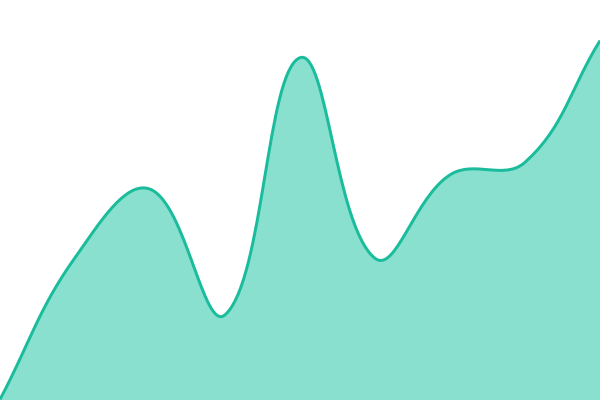
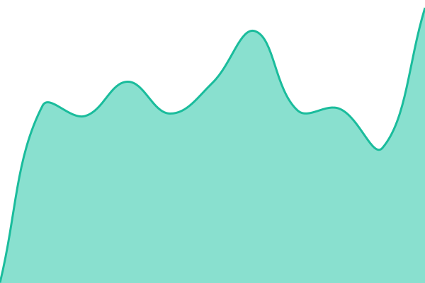
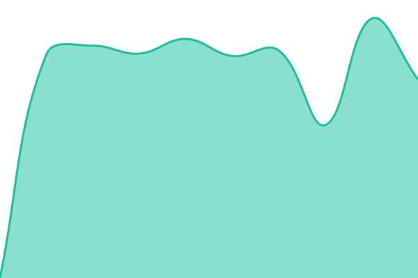
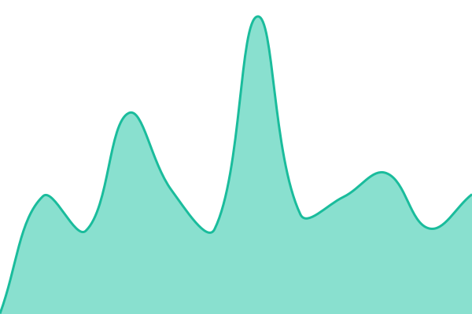
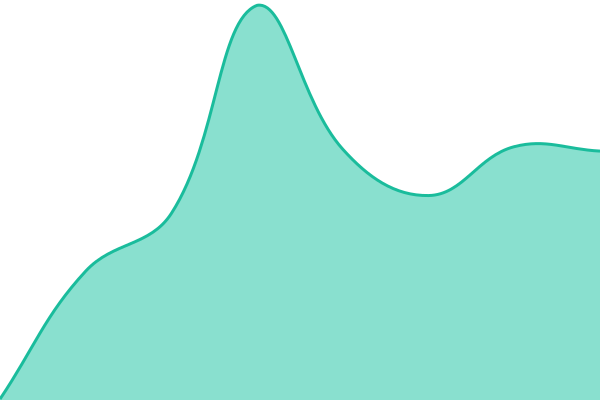
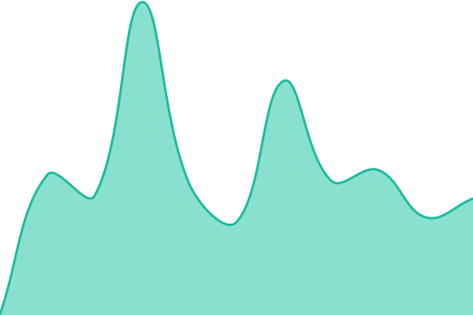
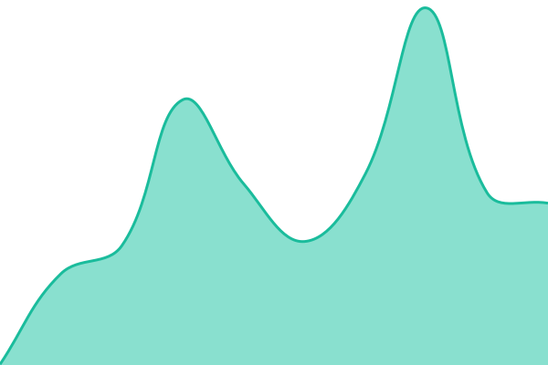
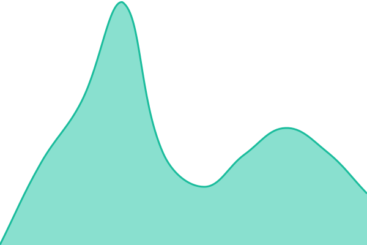
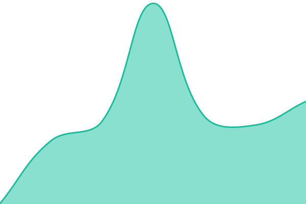

# [📈 Live Status](https://tav-r.github.io/lod4hss_upptime): <!--live status--> **🟧 Partial outage**

This repository contains the open-source uptime monitor and status page for [David](https://tav-r.github.io/lod4hss_upptime), powered by [Upptime](https://github.com/upptime/upptime).

With [Upptime](https://upptime.js.org), you can get your own unlimited and free uptime monitor and status page, powered entirely by a GitHub repository. We use [Issues](https://github.com/tav-r/lod4hss_upptime/issues) as incident reports, [Actions](https://github.com/tav-r/lod4hss_upptime/actions) as uptime monitors, and [Pages](https://tav-r.github.io/lod4hss_upptime) for the status page.

<!--start: status pages-->
<!-- This summary is generated by Upptime (https://github.com/upptime/upptime) -->
<!-- Do not edit this manually, your changes will be overwritten -->
<!-- prettier-ignore -->
| URL | Status | History | Response Time | Uptime |
| --- | ------ | ------- | ------------- | ------ |
|  [LOD4HSS](https://lod4hss.org) | 🟩 Up | [lod-4-hss.yml](https://github.com/tav-r/lod4hss_upptime/commits/HEAD/history/lod-4-hss.yml) | 

 355ms
     
 | 

<a href="https://tav-r.github.io/lod4hss_upptime/history/lod-4-hss">100.00%</a>
    

|  [www Redirect](https://www.lod4hss.org) | 🟩 Up | [www-redirect.yml](https://github.com/tav-r/lod4hss_upptime/commits/HEAD/history/www-redirect.yml) | 

 331ms
     
 | 

<a href="https://tav-r.github.io/lod4hss_upptime/history/www-redirect">100.00%</a>
    

|  [Geovistory](https://geovistory.lod4hss.org) | 🟩 Up | [geovistory.yml](https://github.com/tav-r/lod4hss_upptime/commits/HEAD/history/geovistory.yml) | 

 797ms
     
 | 

<a href="https://tav-r.github.io/lod4hss_upptime/history/geovistory">100.00%</a>
    

|  [Fuseki](https://fuseki.lod4hss.org) | 🟩 Up | [fuseki.yml](https://github.com/tav-r/lod4hss_upptime/commits/HEAD/history/fuseki.yml) | 

 544ms
     
 | 

<a href="https://tav-r.github.io/lod4hss_upptime/history/fuseki">100.00%</a>
    

|  [Outline](https://outline.lod4hss.org) | 🟩 Up | [outline.yml](https://github.com/tav-r/lod4hss_upptime/commits/HEAD/history/outline.yml) | 

 571ms
     
 | 

<a href="https://tav-r.github.io/lod4hss_upptime/history/outline">100.00%</a>
    

|  [GraphDB](https://graphdb.lod4hss.org) | 🟩 Up | [graph-db.yml](https://github.com/tav-r/lod4hss_upptime/commits/HEAD/history/graph-db.yml) | 

 544ms
     
 | 

<a href="https://tav-r.github.io/lod4hss_upptime/history/graph-db">100.00%</a>
    

|  [SPARQL GraphDB](https://sparql-gdb.lod4hss.org) | 🟩 Up | [sparql-graph-db.yml](https://github.com/tav-r/lod4hss_upptime/commits/HEAD/history/sparql-graph-db.yml) | 

 542ms
     
 | 

<a href="https://tav-r.github.io/lod4hss_upptime/history/sparql-graph-db">100.00%</a>
    

|  [Open GraphDB](https://open-gdb.lod4hss.org) | 🟩 Up | [open-graph-db.yml](https://github.com/tav-r/lod4hss_upptime/commits/HEAD/history/open-graph-db.yml) | 

 1187ms
     
 | 

<a href="https://tav-r.github.io/lod4hss_upptime/history/open-graph-db">100.00%</a>
    

|  [Design System](https://design-system.lod4hss.org) | 🟥 Down | [design-system.yml](https://github.com/tav-r/lod4hss_upptime/commits/HEAD/history/design-system.yml) | 

 0ms
     
 | 

<a href="https://tav-r.github.io/lod4hss_upptime/history/design-system">0.00%</a>
    

|  [Elites Suisses](https://elites-suisses.lod4hss.org) | 🟩 Up | [elites-suisses.yml](https://github.com/tav-r/lod4hss_upptime/commits/HEAD/history/elites-suisses.yml) | 

 344ms
     
 | 

<a href="https://tav-r.github.io/lod4hss_upptime/history/elites-suisses">100.00%</a>
    

|  [OntoMe Docs](https://ontome-doc.lod4hss.org) | 🟩 Up | [onto-me-docs.yml](https://github.com/tav-r/lod4hss_upptime/commits/HEAD/history/onto-me-docs.yml) | 

 261ms
     
 | 

<a href="https://tav-r.github.io/lod4hss_upptime/history/onto-me-docs">100.00%</a>
    

|  [NEPOC](https://nepoc.lod4hss.org) | 🟩 Up | [nepoc.yml](https://github.com/tav-r/lod4hss_upptime/commits/HEAD/history/nepoc.yml) | 

 290ms
     
 | 

<a href="https://tav-r.github.io/lod4hss_upptime/history/nepoc">100.00%</a>
    

|  [EOS](https://eos.lod4hss.org) | 🟩 Up | [eos.yml](https://github.com/tav-r/lod4hss_upptime/commits/HEAD/history/eos.yml) | 

 785ms
     
 | 

<a href="https://tav-r.github.io/lod4hss_upptime/history/eos">100.00%</a>
    

|  [Humility](https://humility.lod4hss.org) | 🟩 Up | [humility.yml](https://github.com/tav-r/lod4hss_upptime/commits/HEAD/history/humility.yml) | 

 296ms
     
 | 

<a href="https://tav-r.github.io/lod4hss_upptime/history/humility">100.00%</a>
    

|  [HISB](https://hisb.lod4hss.org) | 🟩 Up | [hisb.yml](https://github.com/tav-r/lod4hss_upptime/commits/HEAD/history/hisb.yml) | 

 339ms
     
 | 

<a href="https://tav-r.github.io/lod4hss_upptime/history/hisb">100.00%</a>
    

|  [Borders](https://borders.lod4hss.org) | 🟩 Up | [borders.yml](https://github.com/tav-r/lod4hss_upptime/commits/HEAD/history/borders.yml) | 

 303ms
     
 | 

<a href="https://tav-r.github.io/lod4hss_upptime/history/borders">100.00%</a>
    

|  [Mathesar](https://lod4hss1.dh.unibe.ch/) | 🟩 Up | [mathesar.yml](https://github.com/tav-r/lod4hss_upptime/commits/HEAD/history/mathesar.yml) | 

 1076ms
     
 | 

<a href="https://tav-r.github.io/lod4hss_upptime/history/mathesar">100.00%</a>
    

|  [AllegroGraph](https://lod4hss1.dh.unibe.ch/agraph/) | 🟩 Up | [allegro-graph.yml](https://github.com/tav-r/lod4hss_upptime/commits/HEAD/history/allegro-graph.yml) | 

 964ms
     
 | 

<a href="https://tav-r.github.io/lod4hss_upptime/history/allegro-graph">100.00%</a>
    

|  [pgAdmin](https://lod4hss1.dh.unibe.ch/pgadmin) | 🟩 Up | [pg-admin.yml](https://github.com/tav-r/lod4hss_upptime/commits/HEAD/history/pg-admin.yml) | 

 1357ms
     
 | 

<a href="https://tav-r.github.io/lod4hss_upptime/history/pg-admin">100.00%</a>
    

<!--end: status pages-->

[**Visit our status website →**](https://tav-r.github.io/lod4hss_upptime)

## 📄 License

- Powered by: [Upptime](https://github.com/upptime/upptime)
- Code: [MIT](./LICENSE) © [Anand Chowdhary](https://anandchowdhary.com)
- Data in the `./history` directory: [Open Database License](https://opendatacommons.org/licenses/odbl/1-0/)
